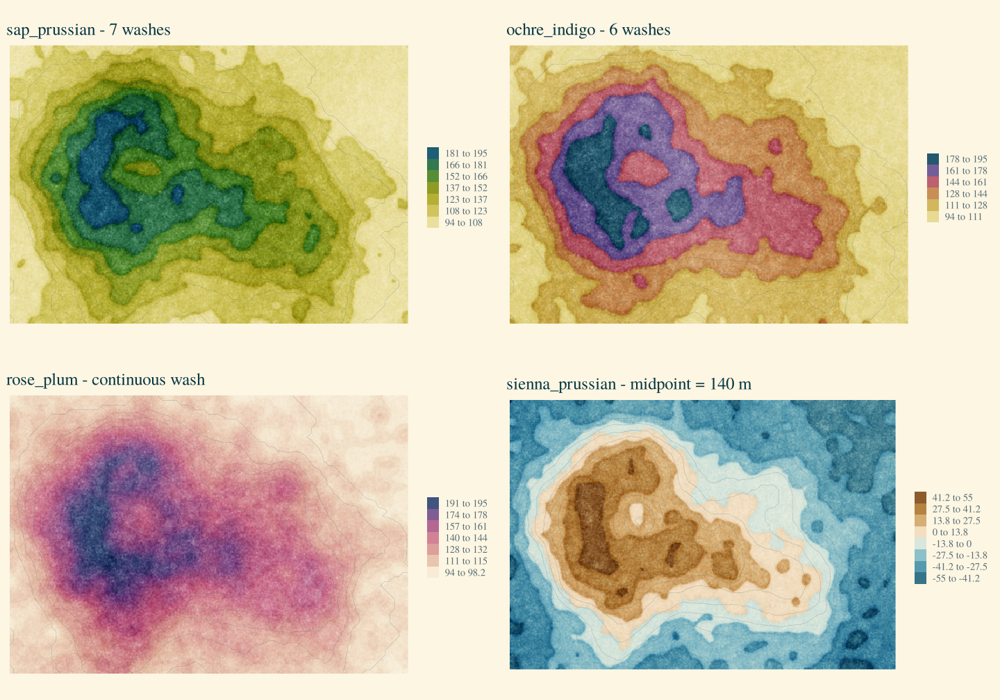

# solarwash

Solarized watercolour palettes for **ggplot2**. 



| palette | runs from | good for |
|---|---|---|
| `sap_prussian` | paper → gamboge → sap green → viridian → prussian blue | elevation, vegetation |
| `ochre_indigo` | paper → ochre → burnt sienna → madder rose → violet → indigo | density, counts |
| `rose_plum` | paper → peach → madder → plum → deep violet | intensity |
| `sienna_prussian` | prussian blue ← paper → burnt sienna (diverging) | anomalies, change |

## Install

```r
# install.packages("remotes")
remotes::install_github("<your-github-user>/solarwash")
```

## Use

```r
library(ggplot2); library(solarwash)

v <- data.frame(x = rep(seq_len(nrow(volcano)), ncol(volcano)),
                y = rep(seq_len(ncol(volcano)), each = nrow(volcano)),
                z = as.vector(volcano))

ggplot(v, aes(x, y, z = z)) +
  geom_watercolor(palette = "sap_prussian", levels = 7, legend_title = "Elevation") +
  coord_fixed(expand = FALSE) + theme_wc()

# for geom
ggplot(v, aes(x, y, fill = z - mean(z))) + geom_raster() +
  scale_fill_wc_b("sienna_prussian", midpoint = 0, n.breaks = 8) + theme_wc()
ggplot(mpg, aes(displ, hwy, colour = cty)) + geom_point() +
  scale_colour_wc_c("ochre_indigo") + theme_wc(grid = TRUE)
ggplot(mpg, aes(class, fill = drv)) + geom_bar() +
  scale_fill_wc_d("rose_plum") + theme_wc()

# raw colours
wc_colors("ochre_indigo", 6)
```

| function | what it does |
|---|---|
| `scale_{fill,colour}_wc_c()` | continuous gradient |
| `scale_{fill,colour}_wc_b()` | binned washes (best fit for the look) |
| `scale_{fill,colour}_wc_d()` | discrete / ordinal |
| `geom_watercolor()` | paints gridded `x, y, z` as textured washes and adds the legend |
| `wc_paint_matrix()` | the same painter for a plain matrix (base graphics, `rasterImage`) |
| `theme_wc()` | paper background with ink text |
| `wc_colors()`, `wc_pal()`, `wc_palettes` | raw palettes |

`geom_watercolor()` texture controls: `granulation`, `edge_pooling`, `bloom`,
`wobble`, `paper_grain`, `seed`. For a near-continuous wash use
`levels = 24, edge_pooling = 0.15`.

- The diverging palette needs `midpoint =`, usually 0.
- `paper = TRUE` lets the lowest values melt into the paper. 
